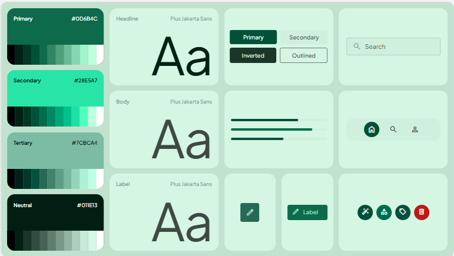
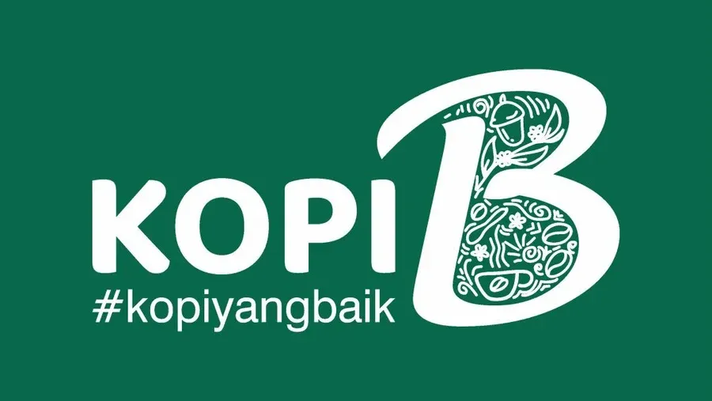

# Dokumentasi Design System "Kopi B" (`#kopiyangbaik`)

Dokumentasi sistem desain antarmuka mobile aplikasi pemesanan kopi **Kopi B**, mengadopsi standar pengalaman pengguna modern premium (serupa Fore Coffee) dengan identitas visual ramah lingkungan dan artisanal. Dokumen ini menjadi acuan tunggal (*Single Source of Truth*) agar seluruh proses desain dan pengembangan Flutter tetap konsisten.

---

## 1. Brand Identity, Logo & Filosofi Visual

- **Nama Brand:** Kopi B
- **Tagline:** `#kopiyangbaik`
- **Konsep Desain:** *Artisanal Botanical Coffee* — memadukan kehangatan seduhan kopi artisanal dengan kesegaran botanical modern, bersih, minimalis, dan berfokus pada kecepatan pemesanan (*Pick Up* & *Delivery*).
- **Anatomi & Penggunaan Logo Resmi (`assets/images/logo_kopi_b.webp`):**
  - **Struktur Visual:** Tipografi bold membulat `KOPI` dengan sub-teks `#kopiyangbaik` di sisi kiri, dipadukan dengan monogram huruf kaligrafi `B` besar di sisi kanan yang berisi ilustrasi *doodle* organik (cangkir kopi, biji kopi, daun, bunga kopi, dan aroma seduhan) berwarna putih di atas latar **Deep Forest Green (`#0D6B4C`)**.
  - **Aturan Penempatan (*Logo Placement*):**
    - **Welcome / Splash Screen:** Ditampilkan penuh di bagian atas / *hero container* berlatar `#0D6B4C` tanpa terpotong.
    - **Home Top Header & Kartu Member (B-Beans):** Ditampilkan dalam container `Deep Forest Green (#0D6B4C)` dengan *corner radius* `12px–16px` dan *clear space* minimal `12px` di sekeliling logo.
    - **Jangan** mengubah proporsi (*stretch*), menimpa logo dengan teks lain, atau meletakkan logo putih di atas background terang tanpa container hijau `#0D6B4C`.
- **Prinsip Utama UI/UX:**
  1. **Clean & Breathable:** Ruang putih (*whitespace*) dan container hijau mint pucat yang menenangkan mata serta menonjolkan fotografi produk kopi.
  2. **Thumb-Friendly Ergonomics:** Elemen interaktif utama berada dalam jangkauan satu tangan (*one-handed navigation*), dengan sudut membulat lembut (*pill & rounded cards*).
  3. **Fast Order Flow:** Meminimalkan jumlah ketukan (*taps*) dari halaman utama hingga *checkout*.

---

## 2. Color Palette System

Sistem warna diekstraksi langsung dari palet kustom *Artisanal Botanical* dan dikelompokkan berdasarkan fungsi semantik UI:

### 2.1 Core Brand & Tonal Palette (Berdasarkan Visual Board)

| Role | Nama Warna | Hex Code | Flutter `Color` | Penggunaan Utama |
| :--- | :--- | :--- | :--- | :--- |
| **Primary** | **Deep Forest Green** | `#0D6B4C` | `Color(0xFF0D6B4C)` | Warna brand utama (daun kopi subur, kualitas premium, sustainability). Digunakan untuk CTA primer, top header, active state ikon, progress fill, dan elemen kunci. |
| **Primary Dark** | **Deep Evergreen** | `#05452E` | `Color(0xFF05452E)` | Warna sub-header gelap, pressed/hover state tombol primer, aksen kontras tinggi. |
| **Secondary** | **Vibrant Mint** | `#28E5A7` | `Color(0xFF28E5A7)` | Aksen interaktif utama untuk badge promo, *reward highlights*, indikator aktif, dan aksen visual segar. |
| **Secondary Dark** | **Emerald Mint** | `#1EB986` | `Color(0xFF1EB986)` | Status sukses, teks/ikon di atas background mint terang, progress bar sekunder. |
| **Secondary Light**| **Soft Mint Mist** | `#B3FEDB` | `Color(0xFFB3FEDB)` | Latar belakang badge promo, kupon diskon, dan *chip tag* aktif. |
| **Tertiary** | **Sage Slate** | `#7CBCA4` / `#82BBAC` | `Color(0xFF7CBCA4)` | Warna pembagi sekunder, border halus kartu, *outlined button* border, dan ikon non-aktif. |
| **Neutral Dark** | **Obsidian Evergreen**| `#011E13` | `Color(0xFF011E13)` | Warna teks primer judul, tombol *Inverted*, dan elemen kontras tinggi yang kokoh & elegan. |
| **Surface Mint** | **Ice Mint Container**| `#E2F5F2` | `Color(0xFFE2F5F2)` | Background container kartu produk, kartu *loyalty member*, *secondary button* fill, dan input *search field*. |
| **Surface Soft** | **Botanical Tint** | `#F4FCF9` | `Color(0xFFF4FCF9)` | Background sekunder layar / section pembagi lembut. |
| **Background** | **Neutral White** | `#FFFFFF` | `Color(0xFFFFFFFF)` | Background utama layar untuk menjaga *clean space* dan *readability* foto produk. |
| **Semantic Error** | **Crimson Berry** | `#C62828` | `Color(0xFFC62828)` | Tombol aksi destruktif (hapus item), pesan error validasi, dan badge stok habis. |
| **Semantic Warning**| **Warm Amber** | `#F59E0B` | `Color(0xFFF59E0B)` | Status pesanan *menunggu pembayaran* atau *rating* bintang. |

### 2.2 Aturan Kontras & Pasangan Warna (*Color Pairing*)
- **On Primary (`#0D6B4C`):** Gunakan teks/ikon `#FFFFFF` (Neutral White) atau `#B3FEDB` (Soft Mint Mist).
- **On Secondary (`#28E5A7` / `#B3FEDB`):** Gunakan teks/ikon `#011E13` (Obsidian Evergreen) atau `#05452E` (Deep Evergreen) agar keterbacaan tetap tinggi.
- **On Surface Mint (`#E2F5F2` / `#F4FCF9`):** Gunakan teks judul `#011E13`, teks deskripsi `#05452E` (opacity 75%), dan ikon `#0D6B4C` atau `#7CBCA4`.
- **On Inverted (`#011E13`):** Gunakan teks `#FFFFFF` atau `#E2F5F2`.

---

## 3. Typography Hierarchy

- **Font Family:** `Plus Jakarta Sans`, sans-serif (modern, ramah, geometris, dan sangat terbaca di layar mobile).
- **Package Flutter:** `google_fonts` (`GoogleFonts.plusJakartaSansTextTheme()`).

### 3.1 Skala Tipografi (*Type Scale*)

| Style Role | Ukuran (`sp`/`px`) | Weight | Line Height | Letter Spacing | Penggunaan |
| :--- | :--- | :--- | :--- | :--- | :--- |
| **Display / Hero** | `28px – 32px` | Bold (`700`) | `1.2` (`36px`) | `-0.5px` | Welcome headline, angka poin B-Beans utama, banner promo besar. |
| **Heading 1 (H1)** | `20px – 22px` | SemiBold (`600`) | `1.3` (`28px`) | `-0.3px` | Judul section utama, nama produk pada halaman detail, judul layar. |
| **Heading 2 (H2)** | `16px – 18px` | SemiBold (`600`) | `1.35` (`24px`) | `-0.2px` | Nama item menu di kartu katalog, nama *outlet store*, harga utama. |
| **Body Text** | `14px` | Regular (`400`) | `1.5` (`21px`) | `0.0px` | Deskripsi rasa kopi, subjudul banner, ulasan pelanggan, alamat. |
| **Body Medium** | `14px` | Medium (`500`) | `1.4` (`20px`) | `0.1px` | Teks tombol (*Button label*), opsi kustomisasi aktif, input teks. |
| **Caption / Meta** | `11px – 12px` | Medium (`500`) | `1.35` (`16px`) | `0.2px` | Label kategori, *badge* promo, harga coret/diskon, info kalori, label *bottom nav*. |

---

## 4. Layout, Grid & Spacing Rules

- **Viewport Acuan:** Mobile Portrait (`390px × 844px`, fluid responsif untuk layar `360px` – `430px`).
- **Spacing Scale (Base 4pt/8pt):**
  - `xs`: `4px` (jarak ikon ke label kecil, antara badge)
  - `sm`: `8px` (jarak antar elemen dalam satu grup kartu)
  - `md`: `12px` (gap antar kartu dalam grid/list)
  - `lg`: `16px` (padding horizontal standar layar / *screen margin*, padding dalam kartu)
  - `xl`: `24px` (jarak antar section di Home & Menu)
  - `xxl`: `32px` (padding atas/bawah area hero)
- **Corner Radius:**
  - **Container / Cards:** `16px` – `20px` (rounded lembut modern).
  - **Buttons, Inputs & Chips:** `12px` (standar tombol/search) hingga `9999px` (*pill-shape* untuk toggle, chip kategori, floating cart, dan bottom nav).
- **Elevation / Shadow:**
  - **Card Shadow:** `BoxShadow(color: Color.fromRGBO(13, 107, 76, 0.08), blurRadius: 16, offset: Offset(0, 4))` — memberikan efek kedalaman natural bernuansa hijau tanpa terlihat abu-abu kaku.
  - **Floating Bar Shadow:** `BoxShadow(color: Color.fromRGBO(1, 30, 19, 0.12), blurRadius: 24, offset: Offset(0, 8))` — untuk *Floating Cart* dan *Bottom Navigation Bar*.

---

## 5. Spesifikasi Komponen UI (Berdasarkan UI Kit Board)

### 5.1 Buttons
Empat varian tombol standar dengan tinggi `44px – 48px`, padding horizontal `20px`, dan corner radius `10px – 12px` (atau `9999px` untuk CTA pill):
1. **Primary Button:**
   - Background: `#0D6B4C` (Deep Forest Green)
   - Text: `#FFFFFF`, SemiBold `14px`
   - Penggunaan: CTA utama (*Pesan Sekarang*, *Tambah ke Keranjang*, *Bayar*).
2. **Secondary Button:**
   - Background: `#D8EFE7` / `#E2F5F2` (Ice Mint Container)
   - Text: `#05452E` (Deep Evergreen), Medium `14px`
   - Penggunaan: Aksi sekunder (*Lihat Detail*, *Ubah Outlet*).
3. **Inverted Button:**
   - Background: `#011E13` (Obsidian Evergreen)
   - Text: `#FFFFFF`, Medium `14px`
   - Penggunaan: Kontras tinggi di atas banner mint terang atau kartu member spesial.
4. **Outlined Button:**
   - Background: Transparan / `#E2F5F2` (opacity rendah)
   - Border: `1.5px solid #4A6B5D` / `#7CBCA4`
   - Text: `#05452E`, Medium `14px`
   - Penggunaan: Filter opsi kustomisasi (Es/Panas, Level Gula), tombol *Batal*.

### 5.2 Action & Icon Buttons
- **Square Icon Action (Soft):** `48px × 48px`, radius `12px`, background `#265C4B`, ikon `#82BBAC` / `#B3FEDB`.
- **Extended Action Pill (FAB):** Tinggi `44px`, radius `10px – 12px`, background `#0D6B4C`, ikon + label `#E2F5F2`.
- **Circular Quick Actions:** Diameter `44px`, bentuk lingkaran (`BoxShape.circle`), background `#0D6B4C` (untuk aksi standar seperti *Customize*, *Category*, *Promo Tag*) dan `#C62828` (untuk aksi *Delete/Remove* dengan ikon putih).

### 5.3 Search Field & Inputs
- Tinggi: `46px – 48px`
- Background: `#DCF2EA` / `#E2F5F2`
- Border: `1px solid #82BBAC`
- Corner Radius: `10px – 12px`
- Ikon & Placeholder: `#4A6B5D` / `#7CBCA4`, teks input `#011E13` (`14px` Regular).

### 5.4 Progress Bar & Loyalty Meter
- Track Background: `#D0EAE1` / `#E2F5F2`
- Fill Active: `#0D6B4C` (Deep Forest Green) atau `#1EB986` (Emerald Mint)
- Tinggi: `6px`, `BorderRadius.circular(999)`
- Penggunaan: Indikator pengumpulan *B-Beans* menuju *Free Cup*, dan status proses pembuatan kopi (*Order Tracker*).

---

## 6. Navigation Architecture (Bottom Navigation Bar)

Bottom navigation persisten terdiri dari **5 destinasi utama** yang dirancang untuk navigasi satu tangan. Menggunakan gaya *floating pill container* (`#DCF2EA` / `#FFFFFF` dengan backdrop blur halus), di mana tab aktif memiliki indikator lingkaran/pill `#0D6B4C` dengan ikon `#FFFFFF`, sedangkan tab non-aktif menggunakan ikon *outlined* `#05452E`.

1. **Home (`Home`)**: Dashboard personalisasi, outlet terdekat, membership *B-Beans*, banner promo, dan rekomendasi menu cepat.
2. **Menu (`Menu`)**: Katalog lengkap kopi, non-kopi, bakery, dengan filter diet/temperatur dan keranjang apung (*floating cart*).
3. **Order (`Order`)**: Riwayat pesanan aktif, pelacakan proses barista (*Brewing* / *Ready for Pick-up*), dan *e-receipt*.
4. **Reward (`Reward`)**: Poin loyalitas "B-Beans", voucher diskon, *stamp card*, dan penukaran gratis kopi.
5. **Akun (`Akun`)**: Profil pengguna, metode pembayaran (GoPay, OVO, ShopeePay, Kartu), alamat tersimpan, dan bantuan.

---

## 7. Screens Overview & Standar Antarmuka

0. **Splash Screen (`lib/features/splash/splash_screen.dart`):**
   - Mengadopsi gaya *full-screen silky botanical wave* khas Fore Coffee menggunakan gradasi diagonal **Deep Forest Green (`#0D6B4C`)**, highlight gelombang zamrud lembut (`#1A966D`), dan bayangan kontur dalam (`#043825`).
   - Menampilkan **Logo Putih Kopi B (`#kopiyangbaik`)** tepat di tengah layar dengan ekstraksi kanal putih transparan (`KopiBLogo(transparentBackground: true)`) sehingga bebas dari kotak latar belakang kaku dan dilengkapi animasi *fade & scale-in* halus.
1. **Welcome & Auth Onboarding Flow (3 Screens — `lib/features/auth/auth_onboarding_screens.dart`):**
   - **Screen 1 (`WelcomeOnboardingScreen`):** Showcase komposisi produk *Kopi B* (2 Iced Coffee Cups berlogo Kopi B + 2 Artisanal Bomboloni Donuts) di atas latar studio bersih, indikator 3 titik (`• • •`), judul hijau `#0D6B4C` *"Semua Favoritmu dalam Satu Aplikasi"*, subjudul *"Praktis pesan kopi dan pastry di Kopi B App!"*, pemilih bahasa pill (`🇮🇩 Indonesia ⌄`), CTA pill penuh **"Masuk"** (`#0D6B4C`), dan tombol **"Lewati tahap ini"** yang langsung mengarah ke **Home Screen**.
   - **Screen 2 (`PhoneLoginScreen`):** Header dengan tombol *back* lingkaran hijau *outlined* (`<`) dan judul **"Masuk"**, label *"Masukkan no telepon"*, pemilih kode negara `+62 ⌄` + field nomor telepon `81234567890`, tombol **"Lanjutkan"** (otomatis berubah dari *disabled grey* `#C5C7C6` menjadi `Primary #0D6B4C` saat nomor valid), serta *disclaimer* **Syarat & Ketentuan** dan **Kebijakan Privasi**.
   - **Screen 3 (`OtpVerificationScreen`):** Header **"Kode OTP"**, instruksi *"Masukkan Kode OTP — Masukkan 6 digit kode OTP yang kami kirimkan ke nomor +62 ..."*, **6 garis bawah OTP** (`_ _ _ _ _ _`) dengan angka OTP yang diketik & kursor vertikal hijau berkedip (`|`), teks hitung mundur *"Kirim ulang kode dalam 00:59"*, dan *custom numeric keypad* modern di bagian bawah yang otomatis memverifikasi dan membuka **Home Screen** saat 6 digit terisi.
2. **Home Screen (`lib/features/home/home_screen.dart`):**
   - **Hero Carousel Banner Atas:** Showcase promosi aksesoris tumbler Kopi B (#kopiyangbaik) dan promo mingguan dengan tombol notifikasi bel di sudut kanan atas.
   - **Floating Welcome Card:** Kartu melayang *"Welcome to Kopi B!"* dengan tombol aksi *"Login Sekarang"* (membuka alur pendaftaran/masuk) dan pemisah garis putus-putus (*dashed line*).
   - **Pesan Kopi B Sekarang?:** Dua kartu pilihan sejajar:
     - **Pick Up:** Aksen Deep Forest Green (`#0D6B4C`), subtitle *"Ambil di store tanpa antri"*, dan ilustrasi barista Kopi B.
     - **Delivery:** Aksen Terracotta Brown (`#8C5828`), subtitle *"Garansi tepat waktu, dijamin!"*, dan ilustrasi kurir skuter Kopi B.
   - **Spesial Untukmu di Kopi B (Grid 2x2):**
     1. *My Kopi B Plan* (Langganan hemat)
     2. *Kopi B Essentials* (Eco-tumbler dengan badge merah *"Baru"*)
     3. *Katering & Kantor* (Pemesanan banyak untuk event)
     4. *Stamp & Rewards* (Game stamp loyalitas 8-cup)
     - Dilengkapi stiker badge melayang *"NEW! KOPI B"*.
   - **Paling Favorit Hari Ini:** Pintasan horizontal kartu produk Best Seller (#kopiyangbaik) dengan tombol *Quick Add* (`+`).
3. **Menu Screen:**
   - Search bar di bagian atas + chip filter cepat.
   - Navigasi kategori kopi interaktif (*Signature Kopi B*, *Espresso Based*, *Non-Coffee*, *Oat Series*, *Pastry*).
   - Bottom sheet / halaman kustomisasi minuman: Pilihan Temperatur (*Iced* / *Hot*), *Sugar Level* (*Normal, Less, No Sugar*), *Milk Option* (*Fresh Milk, Oat Milk*), dan *Extra Shot*.
   - **Floating Cart Bar:** Melayang di atas *Bottom Navigation* saat ada item di keranjang, menampilkan jumlah item, estimasi outlet, dan total harga dengan tombol langsung ke *Checkout*.
4. **Order Screen:**
   - Tab **Dalam Proses** (*Active Orders*) dengan progress bar 3 tahap: *Pesanan Diterima* → *Barista Sedang Menyeduh (Brewing)* → *Siap Diambil / Diantar*.
   - Tab **Riwayat** (*Past Orders*) dengan tombol *Pesan Lagi (Reorder)* satu klik dan unduh *E-Receipt*.
5. **Reward Screen:**
   - Progress kartu loyalitas **B-Beans** dengan visualisasi biji kopi dan *progress bar*.
   - Katalog *Redeem Free Coffee* dan daftar *Voucher Diskon* menggunakan aksen `Vibrant Mint (#28E5A7)` dan `Soft Mint Mist (#B3FEDB)`.
6. **Akun Screen:**
   - Ringkasan profil & level member (*Green Sprout*, *Botanical Brewer*, *Master Bean*).
   - Pengaturan metode pembayaran terhubung (GoPay, OVO, ShopeePay, QRIS, Kartu), daftar alamat tersimpan, preferensi ramah lingkungan (*Bring Your Own Tumbler*), dan pusat bantuan.

---

## 8. Panduan Implementasi Kode (Flutter)

Agar seluruh proses development tetap konsisten:
1. **Jangan gunakan *hardcoded* warna atau font di dalam Widget.** Selalu panggil melalui `AppColors` dan `AppTextStyles` / `Theme.of(context)`.
2. **Struktur Direktori Tema:**
   - `lib/core/theme/app_colors.dart` — Definisi seluruh konstanta warna sesuai Bagian 2.
   - `lib/core/theme/app_text_styles.dart` — Definisi tipografi `Plus Jakarta Sans` sesuai Bagian 3.
   - `lib/core/theme/app_spacing.dart` — Konstanta radius, padding, dan shadow sesuai Bagian 4.
   - `lib/core/theme/app_theme.dart` — Konfigurasi `ThemeData` Material 3 untuk seluruh aplikasi.
3. **Komponen Reusable:** Simpan komponen standar (seperti `KopiButton`, `KopiSearchBar`, `ProductCard`, `BottomNavBar`) di dalam `lib/core/widgets/` atau `lib/shared/widgets/`.

